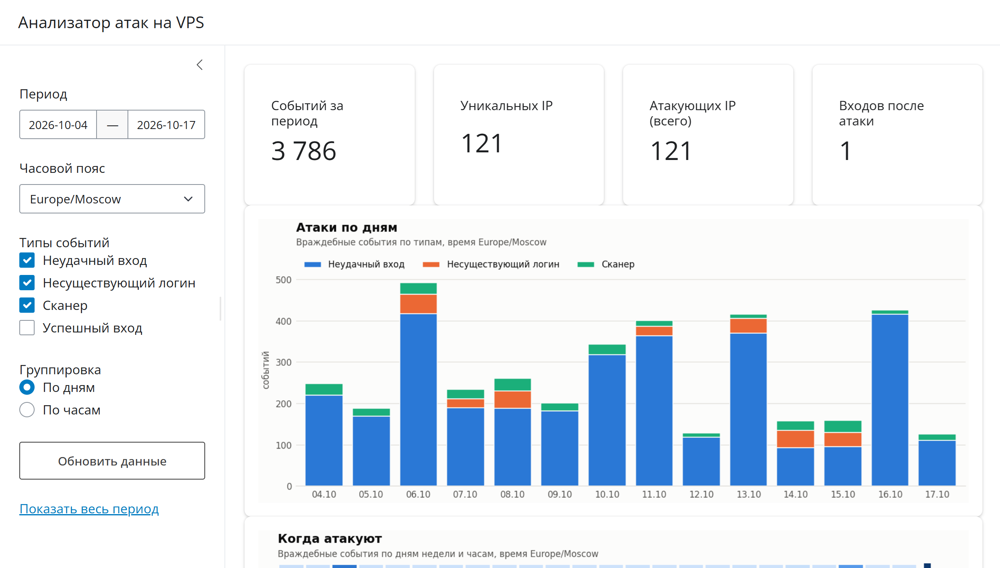
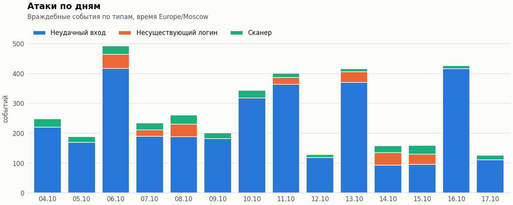
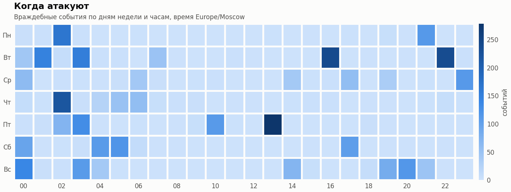
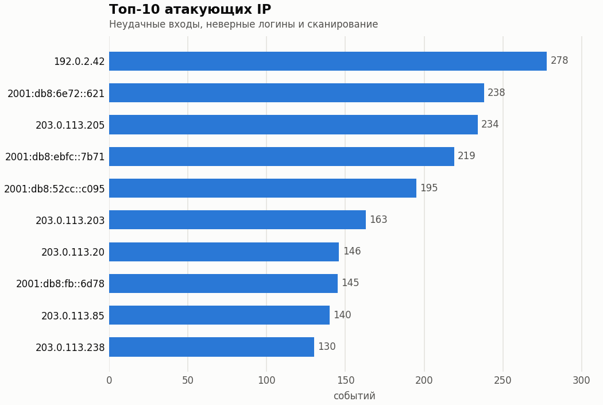
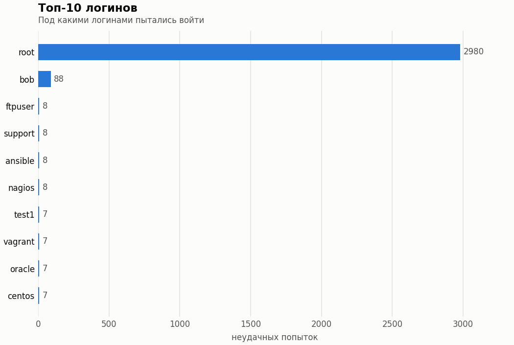

# Анализатор атак на VPS

[](https://github.com/hatyl67/vps-attack-analyzer/actions/workflows/tests.yml)

Находит атаки на SSH по логам Debian-сервера: брутфорс, перебор логинов,
сканеры, повторные атаки и успешный вход после подбора пароля. События
хранятся в SQLite, к ним есть HTTP API, графики и дашборд.



## Возможности

- **Парсер** `auth.log` и вывода `journalctl`: классический и ISO-формат времени,
  сжатые ротации `*.gz`, IPv6, OpenSSH до 10.x (Debian 11–13).
- **Генератор** реалистичного тестового лога с атаками, чтобы работать без сервера.
- **Хранение** в SQLite через SQLAlchemy 2: повторный импорт не создаёт дублей.
- **Детектор**: брутфорс, перебор логинов, повторные атаки, вход после атаки;
  пороги в `config.toml`.
- **HTTP API** на FastAPI с документацией в `/docs`.
- **Графики** на matplotlib и **дашборд** на Shiny for Python.
- **Docker Compose**: API и дашборд одной командой.

## Быстрый старт

Нужен Python 3.9 или новее.

```bash
python -m venv .venv
```

Активировать окружение: `.venv\Scripts\activate` на Windows,
`source .venv/bin/activate` на Linux и macOS.

```bash
pip install -e ".[dev]"
python -m attack_analyzer generate --days 14
python -m attack_analyzer import data/generated/auth.log --tz Europe/Moscow
python -m attack_analyzer serve
```

Во втором терминале:

```bash
python -m attack_analyzer dashboard --tz Europe/Moscow
```

Дашборд: http://127.0.0.1:8001, документация API: http://127.0.0.1:8000/docs.

## Генерация тестового лога

```bash
python -m attack_analyzer generate --days 14 --seed 42 --tz Europe/Moscow
```

Лог пишется в `data/generated/auth.log` (папка `data/` в git не попадает).
Опция `--format iso` даёт время как у rsyslog в Debian 12+:
`2026-10-18T03:14:15.123456+03:00`.

## Разбор лога

```bash
python -m attack_analyzer parse data/generated/auth.log --tz Europe/Moscow
python -m attack_analyzer parse data/generated/auth.log --csv data/events.csv
```

Из Python:

```python
from attack_analyzer.parsers import parse_auth_log

df = parse_auth_log("data/generated/auth.log", tz="Europe/Moscow")
```

Колонки DataFrame: `timestamp` (UTC), `event_type` (`failed_login`,
`invalid_user`, `accepted`, `scanner`), `ip`, `username`, `port`,
`auth_method`, `invalid_user`, `host`, `source`.

### Настоящие логи сервера

Скопируйте лог в `data/raw/` (не коммитится) и укажите пояс сервера:

```bash
# на сервере
sudo cp /var/log/auth.log ~/auth.log && sudo chown $USER ~/auth.log
# или, если rsyslog не установлен (Debian 12+ по умолчанию):
journalctl -u ssh -o short-iso --since "30 days ago" > ~/ssh.log
```

```bash
python -m attack_analyzer parse data/raw/auth.log --tz Europe/Moscow --year 2026
python -m attack_analyzer parse data/raw/auth.log.2.gz --tz Europe/Moscow
```

Сводка показывает число нераспознанных сообщений sshd и примеры: по ним
видно, какие форматы ещё стоит добавить в парсер.

## База данных

```bash
python -m attack_analyzer import data/generated/auth.log --tz Europe/Moscow
python -m attack_analyzer attackers --limit 10
```

`import` разбирает лог и сохраняет события в `data/attacks.db` (SQLite).
Повторный импорт того же или дописанного лога не создаёт дублей: добавляются
только новые события. Другую базу можно указать через `--db` или переменную
окружения `ATTACK_ANALYZER_DB` (адрес в формате SQLAlchemy).

Таблицы:

- `events` — все события: время (UTC), тип, IP, логин, порт, способ входа,
  хост, источник;
- `attackers` — сводка по каждому IP, от которого были неудачные входы,
  неверные логины или сканирование: первое и последнее появление, число
  неудачных входов, неверных логинов, сканирований, успешных входов и разных
  логинов. Пересчитывается после каждого импорта;
- `incidents` — атаки, найденные детектором.

## Детектор атак

`import` после сохранения событий сразу ищет атаки. Чтобы пересчитать их
с другими порогами без повторного импорта:

```bash
python -m attack_analyzer detect
```

Пороги задаются в [`config.toml`](config.toml) (другой файл: `--config` или
переменная `ATTACK_ANALYZER_CONFIG`):

| Вид | Условие | Параметры |
|---|---|---|
| `bruteforce` | не меньше N неудачных входов с IP за окно T | `threshold`, `window_minutes` |
| `enumeration` | не меньше K разных логинов с IP за окно T | `distinct_usernames`, `window_minutes` |
| `repeated` | враждебные события с IP в D разных дней | `min_active_days` |
| `success_after_attack` | успешный вход с IP после M неудачных за последние H часов | `min_failed_before`, `lookback_hours` |

Адрес базы берётся по приоритету: `--db`, затем `ATTACK_ANALYZER_DB`,
затем `[database] url` из `config.toml`.

## Графики

```bash
python -m attack_analyzer charts --tz Europe/Moscow
```

Рисует по событиям из базы четыре PNG в `data/charts/` (папку можно сменить
опцией `--out`, корзину — `--bucket hour/day`). Примеры ниже построены
на сгенерированном логе за 14 дней.









## HTTP API

```bash
python -m attack_analyzer serve
```

Документация с возможностью отправить запрос: http://127.0.0.1:8000/docs.
Для разработки с автоперезапуском:
`uvicorn attack_analyzer.api.app:create_app --factory --reload`.

| Метод | Что возвращает |
|---|---|
| `GET /health` | статус и число событий в базе |
| `GET /events` | события от новых к старым, постранично (`limit`, `offset`) |
| `GET /attackers/top` | топ IP; `order_by`: `failed_logins`, `invalid_users`, `scanner_hits`, `distinct_usernames`, `total_events`, `last_seen` |
| `GET /attackers/{ip}` | сводка по IP и его инциденты |
| `GET /incidents` | найденные атаки; фильтры `kind`, `ip`, `since`, `until` |
| `GET /stats/summary` | всего событий, по типам, уникальных IP, атакующих, инцидентов |
| `GET /stats/timeline` | события по часам или дням (`bucket=hour/day`) с разбивкой по типам |
| `GET /stats/heatmap` | матрица 7x24 «день недели x час» |
| `GET /stats/top-usernames` | самые частые логины (по умолчанию в неудачных входах) |

Общие фильтры событий: `since`, `until` (ISO 8601, время без пояса — UTC,
`until` не включается), `ip`, `username`, `event_type` (можно повторять:
`?event_type=scanner&event_type=invalid_user`). Для `timeline` и `heatmap`
параметр `tz` задаёт пояс группировки, например `Europe/Moscow`.

API только читает данные; события попадают в базу командой `import`.
По умолчанию сервер слушает 127.0.0.1.

## Дашборд

Дашборд берёт данные из HTTP API, поэтому API должен быть запущен.
В двух терминалах:

```bash
python -m attack_analyzer serve
python -m attack_analyzer dashboard --tz Europe/Moscow
```

Откройте http://127.0.0.1:8001. Адрес API задаётся опцией `--api` или
переменной `ATTACK_ANALYZER_API` (по умолчанию http://127.0.0.1:8000).

Что есть на странице:

- период, часовой пояс, типы событий, группировка по дням или часам;
- цифры за период: события, уникальные IP, атакующие IP, входы после атаки;
- графики: атаки по времени, тепловая карта «день недели x час», топ логинов;
- таблица атакующих IP: при выборе строки ниже показываются события этого IP;
- инциденты (вход после атаки выделен цветом) и последние события.

## Docker

Проект запускается и без Docker (всё выше); Docker нужен, чтобы поднять
API и дашборд одной командой, например на сервере.

```bash
docker compose up --build -d
```

- API: http://127.0.0.1:8000/docs
- дашборд: http://127.0.0.1:8001 (часовой пояс: переменная `DASHBOARD_TZ`,
  по умолчанию `Europe/Moscow`)

База лежит в `./data/attacks.db` на хосте (папка монтируется в контейнеры),
пороги детектора берутся из `./config.toml`.

Разовые команды выполняет сервис `cli`:

```bash
# положить лог в ./data/raw/auth.log и импортировать
docker compose run --rm cli import /app/data/raw/auth.log --tz Europe/Moscow
docker compose run --rm cli detect
docker compose run --rm cli charts --tz Europe/Moscow --out /app/data/charts
```

На самом VPS лог можно читать прямо из `/var/log`, смонтировав его только для чтения.
`auth.log` в Debian читают только root и группа `adm` (gid 4), поэтому
команда запускается с этой группой:

```bash
docker compose run --rm --user 1000:4 -v /var/log:/host-log:ro cli import /host-log/auth.log --tz Europe/Moscow
```

Порты открыты только на `127.0.0.1`. Чтобы посмотреть дашборд с сервера
на своём компьютере, используйте SSH-туннель:

```bash
ssh -L 8001:127.0.0.1:8001 -L 8000:127.0.0.1:8000 user@your-vps
```

Контейнеры работают от пользователя с uid 1000. Если на Linux-хосте папка
`data/` принадлежит другому пользователю, выдайте права: `sudo chown -R 1000:1000 data`.

## Тесты

```bash
pytest
```

На GitHub тесты запускаются автоматически при каждом push на Python 3.9 и 3.12,
там же собирается Docker-образ и проверяется, что API и дашборд отвечают.

## Структура

```
src/attack_analyzer/
    models.py           EventType, AuthEvent, IncidentKind, Incident
    config.py           загрузка config.toml
    detector.py         поиск атак по DataFrame событий
    analytics.py        агрегации: ряды по времени, тепловая карта, топы
    charts.py           графики matplotlib
    api/                FastAPI: схемы Pydantic, зависимости, эндпоинты
    dashboard/          Shiny: клиент API и страница дашборда
    parsers/auth_log.py парсер auth.log / journalctl
    storage/            SQLAlchemy: таблицы, подключение, запись и чтение
    generator.py        генератор тестового лога
    cli.py              команды generate, parse, import, detect, attackers, charts, serve, dashboard
tests/                  pytest
config.toml             пороги детектора и адрес базы
docs/images/            картинки для README
Dockerfile, docker-compose.yml
data/                   логи и база (в .gitignore)
```
